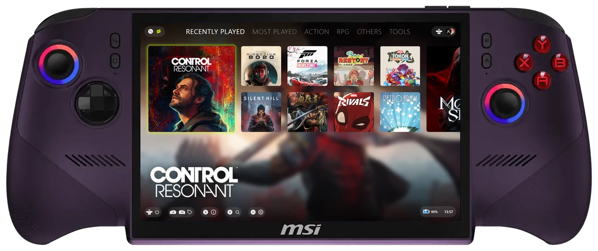
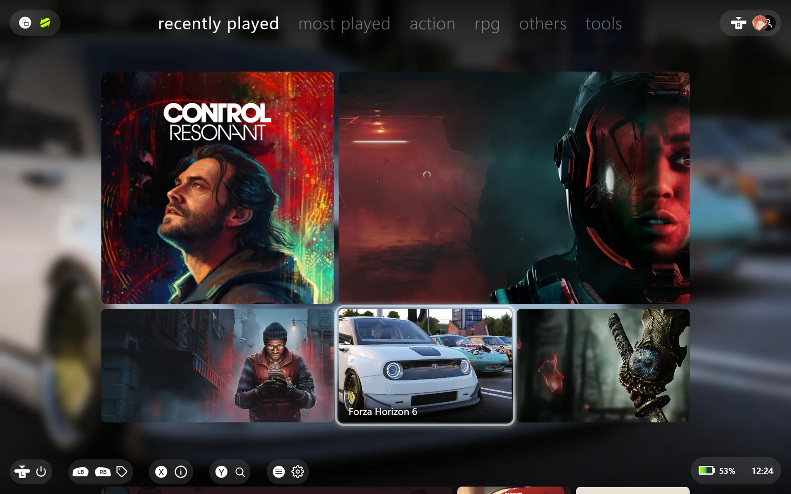
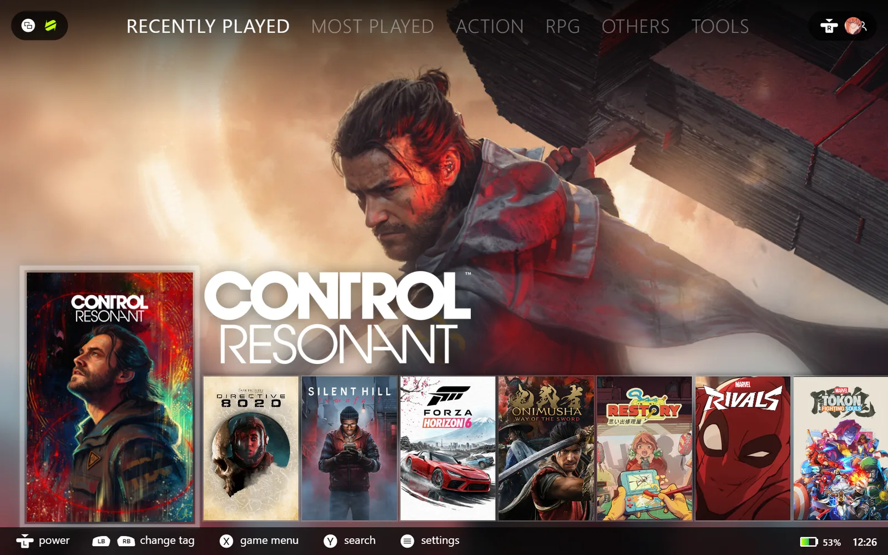
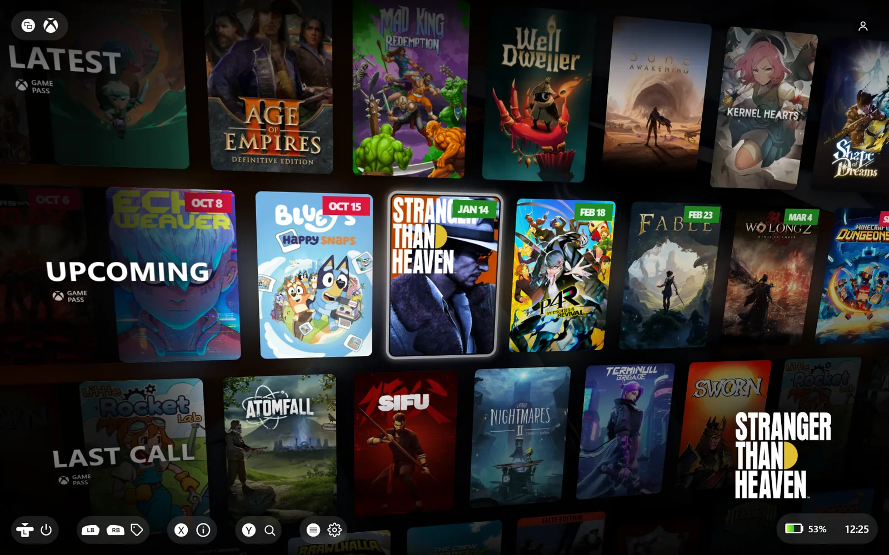
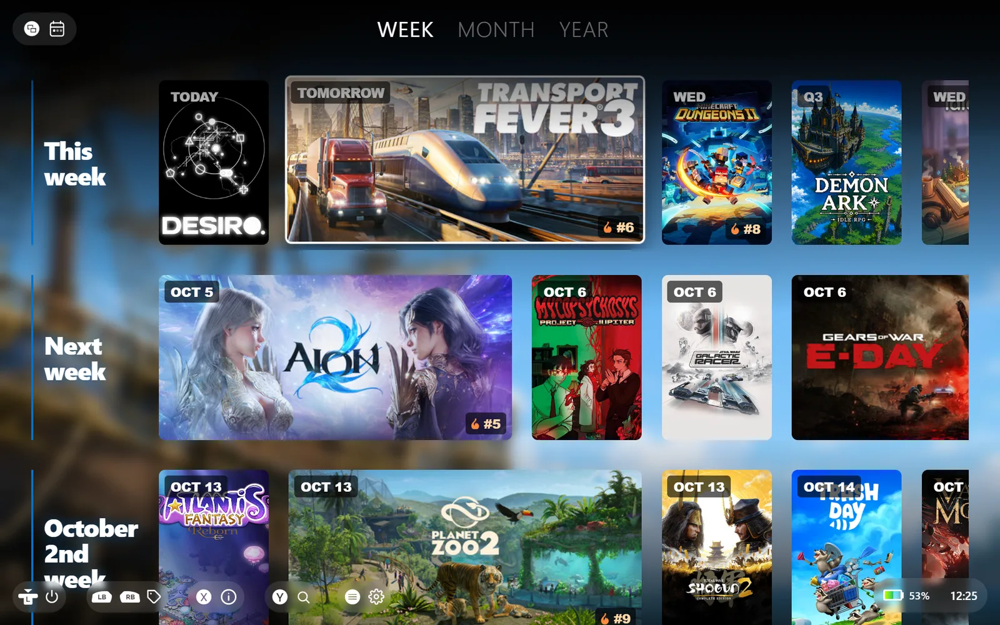
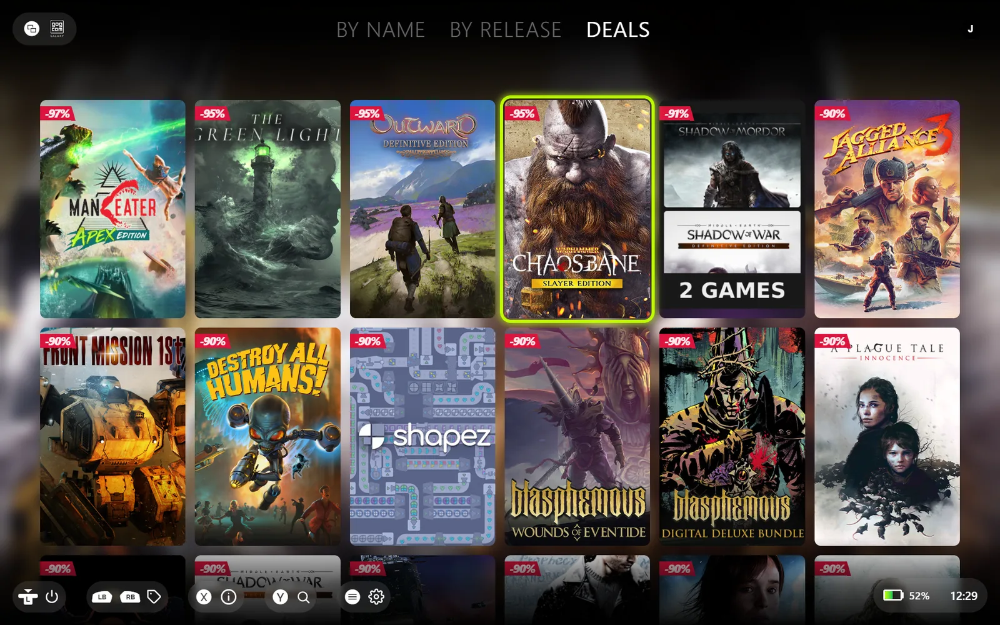
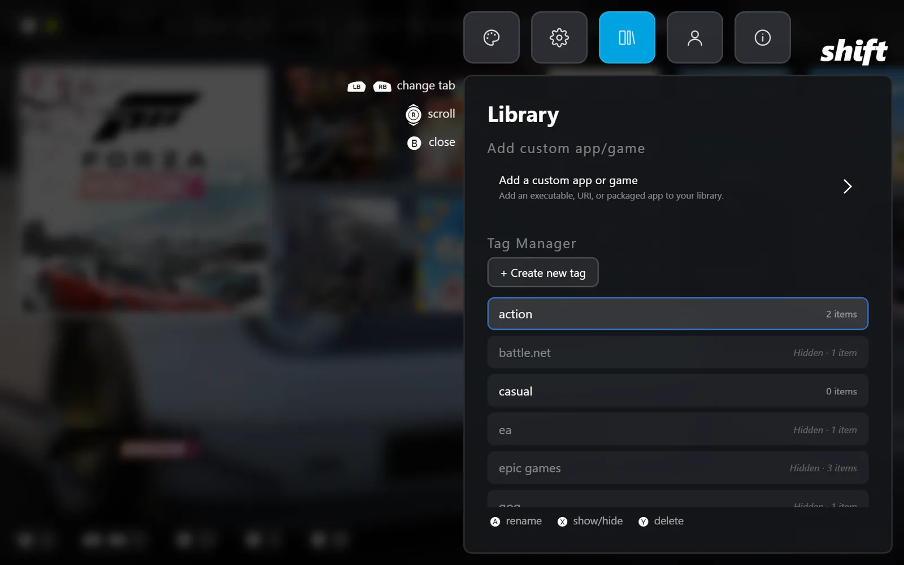

# Shift

**Your whole library, one controller away.**

A controller-first game launcher for Windows handhelds, built for the Xbox Full Screen Experience.

[Download](#download) &nbsp;|&nbsp; [Features](#features) &nbsp;|&nbsp; [Screenshots](#screenshots) &nbsp;|&nbsp; [FAQ](#faq) &nbsp;|&nbsp; [Support](../../issues)

 

 

## Features

- **Every store, one grid.** Steam, Epic Games, GOG, Xbox / Game Pass, Battle.net, Ubisoft Connect and EA app, all in one library.
- **Controller first.** D-pad, sticks, bumpers and an on-screen keyboard. Button hints at the bottom of the screen always show what does what.
- **Built for Xbox Full Screen Experience.** Tested on Windows 11 handhelds running Xbox mode, not just on a desktop.
- **Browse your store catalogs.** See games you own but have not installed yet, and start the install without leaving Shift.
- **Tags, not folders.** Put a game under as many tags as you like, with a built-in Tag Manager and auto tags per store.
- **Playtime tracking.** Recorded automatically and stored locally on your PC.
- **Themes and artwork.** Several layouts (360x, Bento, Spotlight, Shelf, Wall) with official store art or covers from SteamGridDB.
- **Release calendar.** Upcoming and newly added games at a glance.

## Screenshots

<table>
  <tr>
    <td width="50%"> <b>Bento theme</b></td>
    <td width="50%"> <b>Shelf theme</b></td>
  </tr>
  <tr>
    <td width="50%"> <b>Wall theme</b></td>
    <td width="50%"> <b>Release calendar</b></td>
  </tr>
  <tr>
    <td width="50%"> <b>Store catalogs and deals</b></td>
    <td width="50%"> <b>Tag Manager</b></td>
  </tr>
</table>

## Download

| Source | Updates | Notes |
| --- | --- | --- |
| **[Microsoft Store](https://apps.microsoft.com/detail/9PJW4XLWDJLR)** (recommended) | Automatic | Signed by Microsoft, nothing to configure. |
| **[GitHub Releases](../../releases/latest)** | Built-in updater | Download the `.msi` and run it. |

Download counts above only cover GitHub. Installs from the Microsoft Store are counted separately.

## System requirements

- Windows 10 / 11 (x64), Windows 11 Xbox Full Screen Experience supported
- Steam installed for full Steam library support
- Xbox app installed for Game Pass detection

## FAQ

<b>Windows says the installer is from an unknown publisher.</b>

 
The GitHub <code>.msi</code> is not signed with a paid code-signing certificate, so SmartScreen may warn on first run. Choose <b>More info</b>, then <b>Run anyway</b>. The Microsoft Store build is signed by Microsoft and does not show this warning.

<b>Does Shift update itself?</b>

 
Yes. The Store version updates through the Store, and the GitHub version checks this repository for newer releases.

<b>Do I need a mouse or keyboard?</b>

 
No. Every screen is designed to be driven by a gamepad.

<b>I found a bug.</b>

 
Please <a href="../../issues">open an issue</a> and attach the log file from the device where it happened. Logs from the handheld help far more than a description.

## About this repository

This repository hosts installers and release notes only. Each version is published on the [Releases](../../releases) page, newest first.
